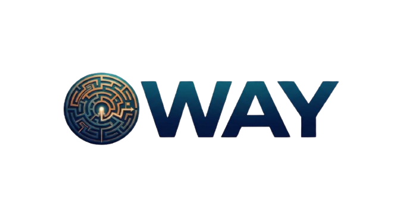
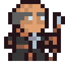
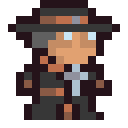
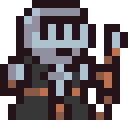
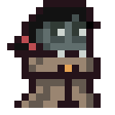

 
<div align="center">
  

  <p align="center">
    
    
    
  </p>
</div>

---

## 🗝️ About the project

> **Oway** is a **maze game** where the player starts in the top left corner of a dungeon and has to **find the way out** to the ladder in the bottom right corner. Every game generates a **brand new maze**, and the player chooses its size from **10x10 to 50x50**.

The game has three modes: **Single player**, where the best times are saved to a **leaderboard**, **Race**, where two players get the same maze on a split screen and the first one out wins, and **Team play**, where a fire and a water hero have to escape together through lava, water, spikes and gates. Race and Team play can be played on **one keyboard** or on **two computers in the same network (LAN)**.


## 🎮  Choose your mode

<div align="center">
  
</div>

| Mode | Players | Goal |
| :--- | :---: | :--- |
| 🧭 **Single player** | 1 | Find the ladder as fast as you can – the best times go to the **leaderboard** |
| ⚔️ **Race** | 2 | Same maze on a **split screen** – the first one out wins |
| 🔥💧 **Team play** | 2 | A **fire** and a **water** hero escape **together** |

<details>
<summary><b>📖 Team play survival guide</b></summary>

<br>

- 🟧 **Lava** is safe only for the fire hero, 🟦 **water** only for the water hero.
- 🔺 Wrong pools and **raised spikes** send you back to the start.
- 🟫 Stand on a **plate** to open the gates for your friend.
- 💎 Collect **all gems** – then escape on the 🪜 **ladder** together.

</details>


## 💾 Installation and Setup

1. 📥 Clone the project using the "Code" button or run:

   ```bash
   git clone https://github.com/IHNoneva24/Oway.git
   ```

2. 📂 Open `Oway/Oway.slnx` in Visual Studio.

3. ▶️ Start the game (**PL** is the startup project).

4. 🧪 To run the automated tests, right-click the **Tests** project → *Set as Startup Project* and start it.


## 🌐 Playing over LAN (firewall script)

Windows Firewall blocks other computers from joining a game, so the player who **hosts** has to allow the game first. The script `setup-firewall.bat` does it in one click:

| Step | 🖥️ Host | 💻 Friend |
| :---: | :--- | :--- |
| 1 | Double-click `setup-firewall.bat` (it is in the main folder of the project and next to the game after building) | – |
| 2 | Windows asks for **administrator rights** – click **Yes** | – |
| 3 | You see *"[OK] Oway can now receive LAN games on TCP port 52025."* | – |
| 4 | **Play** → **Race** or **Team play** → **CO-OP** → **Host game** and tell your friend the IP address on the screen | **Play** → **Race** or **Team play** → **CO-OP** → **Join game** and type the IP |

To remove the rule again, run:

```bash
setup-firewall.bat remove
```

> [!NOTE]
> The player who **joins** doesn't need the script. Both computers must be in the same network, and Windows must see it as a **Private** network (*Settings → Network & Internet → your network → Network profile type*).


## ⌨️ How to play

```text
  1. CHOOSE A MODE ......... Single player, Race or Team play
  2. CHOOSE THE SIZE ....... from 10x10 up to 50x50
  3. MOVE .................. WASD or the arrow keys - you can't walk through walls
  4. ESCAPE ................ find the ladder in the bottom right corner, faster than everyone else!
```

| Key | Action |
| :---: | :--- |
| <kbd>W</kbd> <kbd>A</kbd> <kbd>S</kbd> <kbd>D</kbd> | Move · Player 1 in Race and Team play |
| <kbd>↑</kbd> <kbd>←</kbd> <kbd>↓</kbd> <kbd>→</kbd> | Move · Player 2 in Race and Team play |
| <kbd>Esc</kbd> | Pause / back |
| <kbd>F11</kbd> | Fullscreen / window |


## 🧰 Tech Stack

## • Design
<div align="left">
  
</div>

## • Languages
<div align="left">
  
</div>

## • Libraries
<div align="left">
  
  
</div>

## • Communication
<div align="left">
  
</div>

## • Tools
<div align="left">
  
  
</div>

## • Programs for documents
<div align="left">
  
  
  
</div>


## 📜 Documentation and presentation

- 🎞️ Click here to see the presentation ⮕ [Our Presentation](https://codingburgas-my.sharepoint.com/:p:/g/personal/ihnoneva24_codingburgas_bg/IQALYWk_AM-zTYfZs05i1qKoAROBOrHoFTZr85Q5bXhcfII?e=Pvh8Ds)
- 📘 Open this link to view the documentation ⮕ [Our Documentation](https://codingburgas-my.sharepoint.com/:w:/g/personal/ihnoneva24_codingburgas_bg/IQAvtHRNQGxCRpCWiwQ0Rg3OAe_EZ_I_AOPB76CvSDNJ9kk?e=Zc2JIW)
- ✅ QA table with all tests ⮕ [QA Table](https://codingburgas-my.sharepoint.com/:x:/g/personal/ihnoneva24_codingburgas_bg/IQB8XzDa3qPITpP38OSxtxaDAXDHj95wndz6BRaXvRXvCIc?e=vK0GFE)

<a id="players"></a>

## 👾 PLAYER SELECT · Team Members

<table>
<tr>
<td align="center" width="25%">
<sub><b>PLAYER 1</b></sub><br>
<br>
<a href="https://github.com/MKPavlova24"><b>Maria Pavlova</b></a><br>
<sub>Front-End Developer</sub><br>
<sub>🔴 10B</sub>
</td>
<td align="center" width="25%">
<sub><b>PLAYER 2</b></sub><br>
<br>
<a href="https://github.com/IHNoneva24"><b>Iveta Noneva</b></a><br>
<sub>Scrum Trainer</sub><br>
<sub>🔴 10B</sub>
</td>
<td align="center" width="25%">
<sub><b>PLAYER 3</b></sub><br>
<br>
<a href="https://github.com/GKEnev24"><b>Galin Enev</b></a><br>
<sub>Back-End Developer</sub><br>
<sub>🔴 10B</sub>
</td>
<td align="center" width="25%">
<sub><b>PLAYER 4</b></sub><br>
<br>
<a href="https://github.com/VVMarkov24"><b>Velin Markov</b></a><br>
<sub>QA</sub><br>
<sub>🔵 10G</sub>
</td>
</tr>
</table>

<br>


<h2 align="center">
  If you like the app, you can give a 🌟 to our repository!
</h2>

