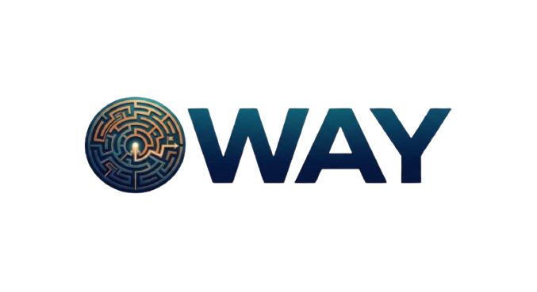

 
<div align="center">
  

  <p align="center">
    
    
    
  </p>
</div>

---

# 📋 About the project

**Oway** is a **maze game** where the player starts in the top left corner of a dungeon and has to **find the way out** to the ladder in the bottom right corner. Every game generates a **brand new maze**, and the player chooses its size from **10x10 to 50x50**.

The game has three modes: **Single player**, where the best times are saved to a **leaderboard**, **Race**, where two players get the same maze on a split screen and the first one out wins, and **Team play**, where a fire and a water hero have to escape together through lava, water, spikes and gates. Race and Team play can be played on **one keyboard** or on **two computers in the same network (LAN)**.

# ⚙️ Installation and Setup

1. 📥 Clone the project using the "Code" button or run:

   ```bash
   git clone https://github.com/IHNoneva24/Oway.git
   ```

2. 📂 Open `Oway/Oway.slnx` in Visual Studio.

3. ▶️ Start the game (**PL** is the startup project).

4. 🧪 To run the automated tests, right-click the **Tests** project → *Set as Startup Project* and start it.

# 🔥 Playing over LAN (firewall script)

Windows Firewall blocks other computers from joining a game, so the player who **hosts** has to allow the game first. The script `setup-firewall.bat` does it in one click:

1. 🖱️ On the computer that **hosts** the game, double-click `setup-firewall.bat` (it is in the main folder of the project and next to the game after building).

2. 🛡️ Windows asks for **administrator rights** – click **Yes**.

3. ✅ You see *"[OK] Oway can now receive LAN games on TCP port 52025."*

4. 🎮 Start the game → **Play** → **Race** or **Team play** → **CO-OP** → **Host game** and tell your friend the IP address on the screen. Your friend chooses **Join game** and types it.

To remove the rule again, run:

```bash
setup-firewall.bat remove
```

> 💡 The player who **joins** doesn't need the script. Both computers must be in the same network, and Windows must see it as a **Private** network (*Settings → Network & Internet → your network → Network profile type*).

# 🕹 How to play

1. Choose a game mode: Single player, Race or Team play.
2. Choose how big the maze should be (10x10 – 50x50).
3. Move with **WASD** or the **arrow keys** – you can't walk through walls.
4. Find the ladder in the bottom right corner and escape faster than everyone else!

| Key | Action |
|------|-------|
| **WASD / Arrow keys** | Move (Race and Team play: Player 1 – WASD, Player 2 – Arrows) |
| **ESC** | Pause / back |
| **F11** | Fullscreen / window |

# 🛠️💻 Tech Stack

## 🎨 Design
<div align="left">
  
</div>

## 💬 Languages
<div align="left">
  
</div>

## 📚 Libraries
<div align="left">
  
  
</div>

## 📞 Communication
<div align="left">
  
</div>

## 🛠️ Tools
<div align="left">
  
  
</div>

## 📄 Programs for documents
<div align="left">
  
  
  
</div>

# 📁 Documentation and presentation

- Click here to see the presentation ⮕ [Our Presentation](ADD-THE-LINK-HERE)
- Open this link to view the documentation ⮕ [Our Documentation](ADD-THE-LINK-HERE)
- QA table with all tests ⮕ [QA Table](Documents/QA%20Table%20Oway.xlsx)

# 👥 Team Members

| Name | Role | Grade |
|------|-------|--------|
| [**Maria Pavlova**](https://github.com/MKPavlova24) | Front-End Developer | 🔴 10B |
| [**Iveta Noneva**](https://github.com/IHNoneva24) | Scrum Trainer | 🔴 10B |
| [**Galin Enev**](https://github.com/GKEnev24) | Back-End Developer | 🔴 10B |
| [**Velin Markov**](https://github.com/VVMarkov24) | QA | 🔵 10G |

<h2 align="center">
  If you like the app, you can give a 🌟 to our repository!
</h2>
